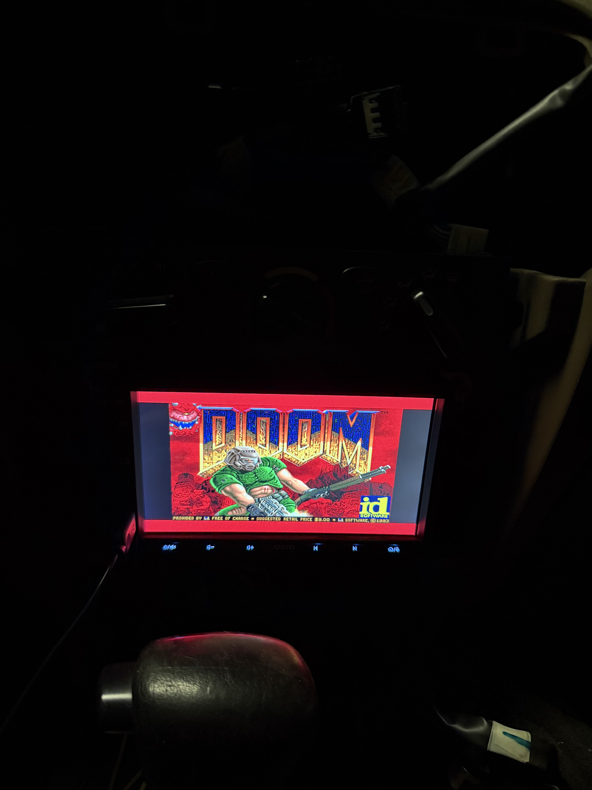

# DOOM on the ATOTO F7

Native DOOM on the F7's Sunplus Linux SoC, running over the stock UI: picture, a USB
keyboard, sound effects and OPL music. Press **F12** on the stock UI to play; press **F12**
again (or use the in-game Quit) to return to the screen you were on.



Tested on an F7G2A7XE, SoC firmware `F7-SOC5P-230609`. Other builds may differ. Read
[../DISCLAIMER.md](../DISCLAIMER.md) first.

**Nothing here is ATOTO code, and no WAD is included.** You supply the shareware
`doom1.wad` yourself.

## What you need

- A **root shell** on the unit at boot. See the two install options below.
- A **USB keyboard plugged in through a USB 2.0 hub.** The F7's kernel deliberately refuses
  *low-speed* USB devices on its own ports, and most cheap keyboards (e.g. Logitech K120) are
  low-speed. Behind a USB 2.0 hub they work fine. Hot-plugging the hub while the unit runs is OK.
- A FAT32 USB stick for the files, and `doom1.wad` (shareware, freely available).
- To build: [zig](https://ziglang.org) (used as the ARM cross-compiler) and `make`.

## Build

```sh
cp /path/to/doom1.wad doom/wad/doom1.wad    # optional: bundled into dist/ if present
./doom/build.sh                             # -> doom/dist/doom/
```

`dist/doom/` holds `fbdoom`, `f7doomd`, `mcu_keepalive`, `doom_run.sh`, `start.sh` (and the
WAD if you added it). Everything is statically linked; nothing depends on the unit's libraries.

## Install: option A, the USB debug stick from this repo

Use the hook and stick described in the [main README](../README.md#1-root-shell-via-usb-debug-stick),
which runs `debugnet.sh` from the stick at every boot.

1. Copy `dist/doom/` to the root of that stick as `doom/` (and `doom1.wad` into it).
2. Append one line to the end of the stick's `debugnet.sh`:

   ```sh
   sh "$HERE/doom/start.sh"
   ```

   (`$HERE` is the stick's mount point; [`scripts/debugnet.sh`](../scripts/debugnet.sh)
   already sets it.)
3. Boot with the stick in. `start.sh` launches `f7doomd`, which waits for F12.

This needs the boot hook, i.e. a rootfs you've reflashed (see
[FLASH_AND_RECOVERY.md](../FLASH_AND_RECOVERY.md)). Pull the stick and the unit is stock again.

## Install: option B, you already have a root shell

If you already have a shell some other way and don't want to reflash:

1. Put `dist/doom/` (plus `doom1.wad`) anywhere the unit can read, e.g. a USB stick
   (mounted at `/mnt/sda1` on this unit) or `/media/flash/nvm`.
2. Start the launcher from your shell:

   ```sh
   sh /mnt/sda1/doom/start.sh
   ```

It runs until the next reboot, so re-run it after each boot, or call it from whatever
boot-time hook you have.

## Controls

| Key | Action |
|---|---|
| **F12** | launch DOOM from the stock UI / quit back to it |
| Arrows | move / turn |
| Ctrl | fire |
| Space | use (doors, switches) |
| Shift | run |
| Alt | strafe |
| 1–7 | weapons |
| Enter / Esc | menu |

## How it works

- **Video.** The panel is an eCos-composited OSD layer behind `/dev/fb0` (800×480 ARGB8888,
  double-buffered). Two things are required, and plain framebuffer code gets both wrong:
  pixels must be **opaque** (alpha 0xFF; alpha 0 is transparent, i.e. black), and every frame must
  be page-flipped with `FBIOPAN_DISPLAY`, which is what hands the buffer to the eCos display.
- **Running over the stock UI.** `doom_run.sh` saves the UI's framebuffer, **pauses** `appman`
  (`SIGSTOP`; killing it doesn't recover cleanly), runs DOOM, then restores the screen and resumes
  `appman`.
- **MCU watchdog.** `appman` normally sends the companion MCU a watchdog frame on `/dev/ttyS1`
  (115200 8N1). With `appman` paused, `mcu_keepalive` sends it instead
  (`7E 00 00 00 00 00 02 1A 01 A3 C7 7C` every 3 s), or the MCU power-resets the SoC within ~10 s.
- **Input.** DOOM reads every `/dev/input/event*` device and grabs them exclusively (`EVIOCGRAB`) so
  keys and screen taps don't queue up for the paused UI. It also listens for a simple UDP
  "network keyboard" on port 5555 (see `src/fbdoom/i_input_f7.c`) while it runs.
- **Audio.** There's no ALSA/OSS; audio goes through the firmware's `as_server` to eCos. DOOM mixes
  44.1 kHz stereo (sound effects plus music from Chocolate Doom's OPL emulator) into a FIFO that the
  firmware's own `/usr/local/bin/as_track` plays at the head unit's current volume.
- **Launcher.** `f7doomd` watches keyboards for F12 (rescanning every 2 s) and runs a `/tmp` copy of
  `doom_run.sh`.

## Known issues

- During testing the unit reset twice mid-game; the cause wasn't found and it didn't recur over later
  sessions. `doom_run.sh` appends a 5-second heartbeat to `doom/run.log` on the stick so a reset
  leaves a trail. A reset is harmless (everything runs from RAM) and the unit boots normally.
- The area outside DOOM's 640×400 picture isn't cleared.
- Memory is tight (Linux gets ~61 MB, and DOOM runs on top of the paused UI).
- If a phone tries to start CarPlay while DOOM runs, the request waits and is handled when you quit.

## Layout

```
build.sh                 cross-build everything and assemble dist/doom/
src/fbdoom/              fbDOOM + F7 changes; i_video_fbdev.c, i_input_f7.c, i_sound_pipe.c,
                         opl_pipe.c, i_system.c, m_config.c are the F7-specific parts
launcher/                f7doomd.c (F12 watcher), doom_run.sh (pause/run/restore), start.sh
keepalive/               mcu_keepalive.c (MCU watchdog keepalive)
docs/                    photos
```

## Credits and license

This directory is **GPL-2.0** (see [COPYING](COPYING)), unlike the MIT-licensed rest of the repo,
because it is derived from:

- [fbDOOM](https://github.com/maximevince/fbDOOM) by Maxime Vincent (GPL-2.0),
- [Chocolate Doom](https://www.chocolate-doom.org) 2.1.0 by Simon Howard and contributors
  (`opl*`, `dbopl*`, `midifile*`, `mus2mid*`, `i_oplmusic.c`; GPL-2.0),
- the DOOM source release by id Software (GPL-2.0).

DOOM is a trademark of id Software. ATOTO and Sunplus marks belong to their owners; nothing here is
affiliated with or endorsed by them.
